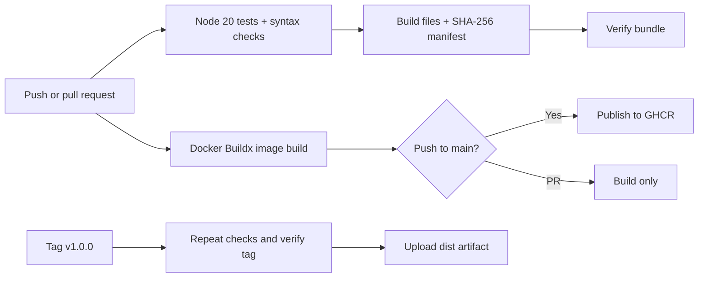

# Pipeline Room — my CI/CD practice area (2024 stack)

After working with Docker containers, I wanted to understand how an application goes from a Git push to a checked build. I made a small release-status API so there is something real to test and package. Then I wired up GitHub Actions for the steps that I would otherwise do manually.

This part of the repo focuses on **implementation**, not a big list of DevOps definitions.

## What is here?

| Folder | What I use it for |
| --- | --- |
| `build-lab/` | Small Node.js API, tests, Docker image and release bundle with SHA-256 manifest |
| `workflow-files/` | Three Actions workflows: code checks, Docker image, and tagged release artifact |
| `commands/` | PowerShell/Git Bash commands to run CI locally and copy workflows to the correct place |
| `notes/` | Pipeline sketch, workflow permissions, version choices, common mistakes |
| `practice/` | Deliberately break something and see whether the pipeline catches it |

All of these files belong inside **`pipeline-room/`**. The ZIP has no extra `pipeline-room/` folder.

## Start here on Windows

I already have `container-workbench/` from the previous section. This folder should sit next to it:

```text
cloud-devops-platform-engineering/
├── container-workbench/
│   └── service-status-api/
└── pipeline-room/               # extract ZIP contents here
    ├── build-lab/
    ├── workflow-files/
    ├── commands/
    ├── notes/
    └── practice/
```

### 1. Test the demo API first

Open PowerShell at the repository root:

```powershell
cd pipeline-room\build-lab
npm ci
npm test
npm run build
npm run verify
npm run start:dist
```

`npm ci` installs using the committed lockfile. It is intentionally dependency-free at runtime and only relies on Node.js. The API listens on http://localhost:3000.

### 2. Install the GitHub Actions workflow files

GitHub will **not** run workflows kept under `pipeline-room/workflow-files/`. Workflows are only discovered when they are placed under `.github/workflows/` at the root of the Git repository.

Go back to the repository root, then run:

```powershell
powershell -File .\pipeline-room\commands\install-workflows.ps1
```

The command copies the three YAML files to `.github/workflows/`. It checks for the earlier `container-workbench` service and does not overwrite existing files without `-Overwrite`.

### 3. Run the local check before committing

```powershell
powershell -File .\pipeline-room\commands\run-local-ci.ps1
git status
git diff --check
```

Review the changes, then commit from the repository root. A PR touching this lab will trigger tests and a Docker build. A push to `main` will also try to publish a Docker image to GitHub Container Registry (GHCR). Publishing depends on repository/org package permissions.

### 4. Try a release tag (after pushing code)

When `package.json` says `1.0.0`, a tag `v1.0.0` triggers release verification and saves the bundled `dist/` folder as a workflow artifact. It doesn't publish a GitHub Release automatically.

```powershell
git tag v1.0.0
git push origin v1.0.0
```

Only create/push a release tag when you actually intend to run the workflow. If you change the app's version, update the tag as well.

## How the pipeline flows



## Things this is *not*

- It is a local/demo service with a fake build history, not a real deployment dashboard connected to GitHub.
- A working GH Actions workflow is different from a proven production deployment. No real server or cloud environment is deployed here.
- The GitHub Actions major versions and Node version are chosen to fit a 2024-era learning setup. **These older versions are not a recommendation to deploy unchanged in 2026.** Review security fixes and supported runtimes before putting this into production.
- Builds and unit tests were run here; GitHub-hosted jobs, GHCR publishing and Docker builds require testing on the actual GitHub/Windows setup.

## What I would improve later

1. Add a database or fetch build history from the GitHub API instead of using JSON fixtures.
2. Replace the educational SHA-256 manifest with signed provenance/attestations.
3. Add a deploy job with an explicit staging environment approval instead of publishing images only.
4. Pin Actions to full commit SHAs after validating them, and upgrade maintained runtimes.

References for workflow syntax: https://docs.github.com/en/actions and https://docs.docker.com/build/ci/github-actions/ .
