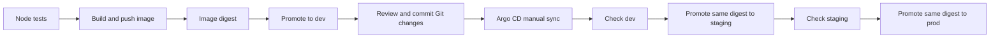

# How the release moves

The Git repo stores what should be deployed. Argo CD watches the repo, but **these sample Applications do not enable automatic sync**. The script edits the overlay and local ledger; it has no direct Kubernetes access.

The main idea is that staging and production should run the **same image digest** already checked in the previous environment, rather than rebuilding different images.

For a real company system, I would add signed artifacts, branch protection, approval gates, proper alerting, and a more reliable release database. The JSON ledger in this lab is mainly useful for understanding the workflow.
